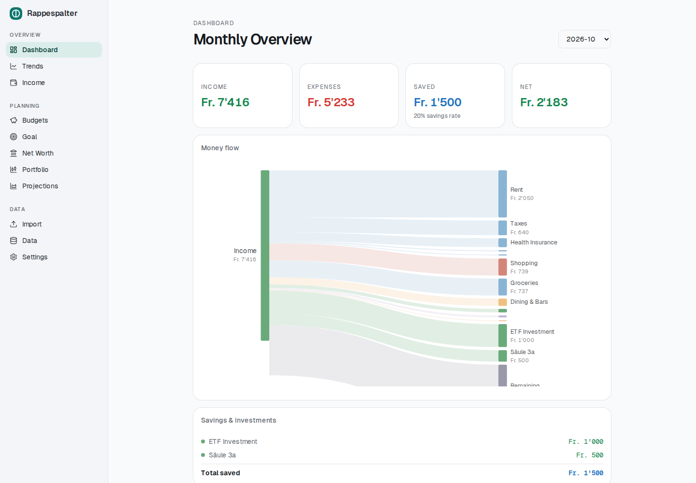
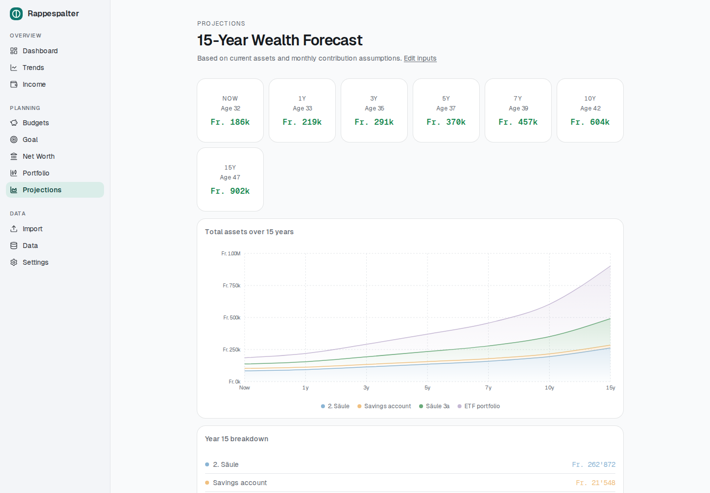
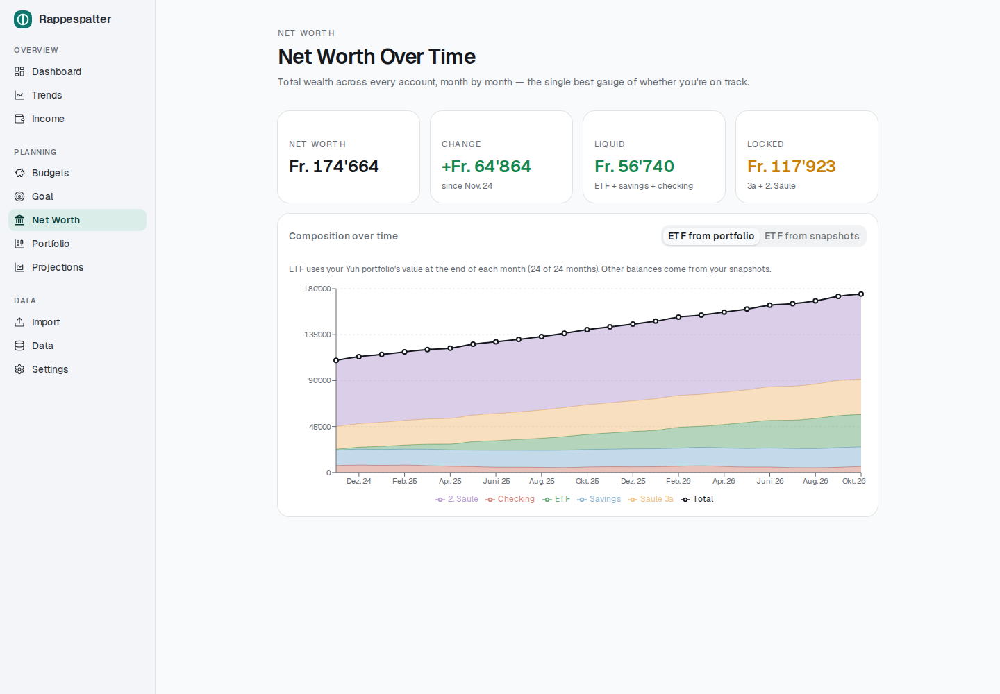
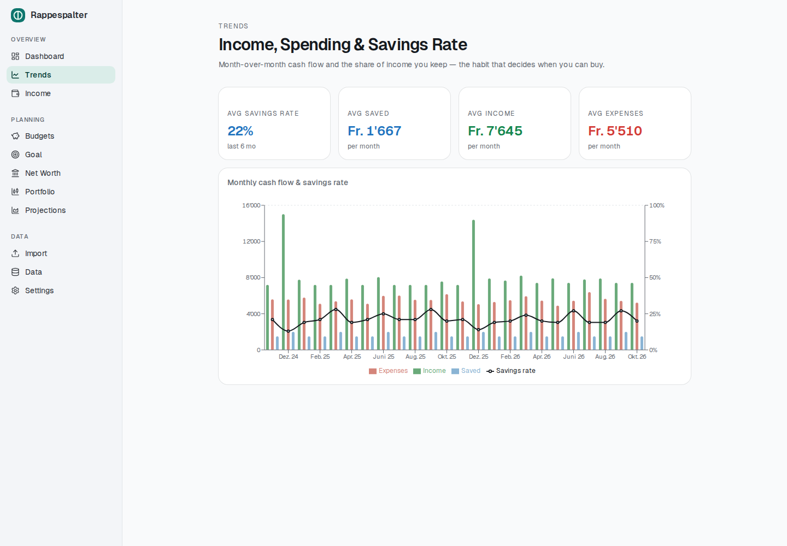

# Rappespalter

A **local-first personal finance dashboard** for tracking monthly spending, savings, net worth, and long-term wealth projections. You import your bank statements, and everything is stored and computed on your own machine — no cloud, no accounts, nothing leaves your computer.

Built for a Swiss context (CHF, pillar 2 / pillar 3a, Raiffeisen exports), but the core works for any spending/savings tracking.

---

## Screenshots

> 📸 _Placeholders — drop your images into `docs/screenshots/` with these names and they'll render here._

| Dashboard | Projections |
| --- | --- |
|  |  |

| Net Worth | Trends |
| --- | --- |
|  |  |

<!--
To add screenshots:
  1. Run the app (pnpm dev) and capture each page.
  2. Save PNGs as docs/screenshots/{dashboard,projections,networth,trends}.png
  3. Commit them — the images above will display automatically.
Add more rows for import / budgets / income / goal / data as desired.
-->

---

## Features

### 📊 Dashboard
Monthly spending overview with drill-downs.
- Income / Expenses / Saved / Net stat cards, each clickable to inspect the underlying transactions
- Spending allocation (Fixed / Variable / Savings) and an expense-by-category pie chart
- Budget vs. actual progress bars per category
- Largest outflows and a separate savings & investments list
- Sortable, searchable transaction drill-down dialog

### 📥 Import
Upload a Raiffeisen **Finanzassistent** `.xlsx` export.
- Drag-and-drop or browse
- Automatic German→English category mapping
- Internal-transfer filtering (so credit-card settlements aren't double-counted)
- Deduplicated on re-import — re-uploading the same file imports nothing twice
- Reports imported / skipped / total counts

### 💰 Budgets
Set monthly CHF limits per category; totals roll up and feed the dashboard's budget bars.

### 📈 Trends
Income, expenses, saved, and savings-rate over time (the in-progress month is excluded so averages aren't skewed). Six-month averages for savings rate and cash flow.

### 🏦 Net Worth
Net-worth history built from monthly balance snapshots — stacked composition (checking, savings, ETF, pillar 3a, pillar 2) plus a total line, split into liquid vs. locked assets.

### 📉 Portfolio
Standalone investment tracker fed by **Yuh** activity CSV exports. Holdings are matched to market listings automatically (by the currency and price of your first trade — no hard-coded tickers) and valued at daily closing prices, converted to CHF.
- Value over time vs. net deposits, with 3M / 6M / 1Y / All ranges
- Time-weighted and money-weighted (IRR) returns
- Holdings: units, average cost, price, gain, weight — filterable by ETFs / stocks
- Dividends per month and per holding, withholding tax, yield on cost; trading & FX fees
- Per-holding price source: auto-matched listing, a listing you choose, or manual prices
- Independent of the rest of the app: nothing here feeds spending, savings or net worth

### 💵 Income
Income broken down by source (category) with a monthly stacked trend, year filter, top-source ranking, and a transaction drill-down.

### 🎯 Goal
Down-payment tracker for a property purchase. Enter price, down-payment %, and extra costs; it projects an on-track date from your trailing 6-month **liquid** savings rate (deliberately conservative — ignores ETF growth and locked pension assets). Inputs persist in your browser.

### 🔮 Projections
15-year wealth forecast. Record balance snapshots, then the engine compounds each asset class (default rates: ETF 6%, pillar 3a 5%, savings 0.75%, pillar 2 2.5%) plus your monthly contributions, with checkpoints at 0/1/3/5/7/10/15 years and a CHF 1M milestone banner. Contribution amounts, starting age and opening balances are edited on the **Settings** page (defaults come from environment variables — see [Configuration](#configuration)).

### 🗄️ Data
A built-in database browser: paginated, filterable transaction table with inline category re-mapping, plus tabs for categories, budgets, and snapshots.

### 🖥️ Desktop app
Runs as a native desktop application via Electron — see [Desktop app](#desktop-app).

---

## Tech stack

- **Next.js 16** (App Router, Turbopack) + **React 19** + **TypeScript**
- **Tailwind CSS 4** + shadcn/ui (Radix) components
- **Recharts** for charts
- **Prisma 7** over **SQLite**, via the `@prisma/adapter-libsql` driver adapter
- **Electron** for the desktop build
- **pnpm** package manager (Node.js 22+)

---

## Getting started

### Prerequisites
- **Node.js 22+**
- **pnpm** (`npm install -g pnpm`, or via Corepack)

### Install & set up

```bash
# 1. Install dependencies
pnpm install

# 2. Create your local env file
cp .env.example .env       # Windows: copy .env.example .env

# 3. Create the SQLite database, apply migrations, and seed default categories
pnpm dlx prisma migrate dev

# 4. (re)generate the Prisma client — usually run by step 3, safe to repeat
pnpm dlx prisma generate

# 5. Start the dev server
pnpm dev
```

Open **http://localhost:3000**. The database file `dev.db` is created in the project root and is **gitignored** — your financial data never enters version control.

### Import your data
1. In Raiffeisen e-banking, open **Finanzassistent** and export your transactions as `.xlsx`.
2. Go to **Import** in the app and upload the file.
3. Head to the **Dashboard** — months populate automatically.

> Only Raiffeisen's Finanzassistent format is parsed today (see [`src/lib/parser.ts`](src/lib/parser.ts)). Adapting the column mapping for another bank is the main change needed for other formats.

---

## Configuration

All config lives in `.env` (gitignored — copy from [`.env.example`](.env.example)).

| Variable | Purpose | Default |
| --- | --- | --- |
| `DATABASE_URL` | SQLite file location | `file:./dev.db` |
| `NEXT_PUBLIC_MONTHLY_ETF` | Monthly ETF contribution (projections) | `0` |
| `NEXT_PUBLIC_MONTHLY_3A` | Monthly pillar 3a contribution | `0` |
| `NEXT_PUBLIC_MONTHLY_PILLAR2` | Monthly pillar 2 contribution | `0` |
| `NEXT_PUBLIC_START_AGE` | Your age (projection x-axis start) | `30` |
| `NEXT_PUBLIC_INIT_ETF` / `_SAVINGS` / `_PILLAR3A` / `_PILLAR2` | Opening balances used only when no snapshot exists yet | `0` |

The `NEXT_PUBLIC_*` values are only **defaults** for the **Settings** page — anything saved there takes precedence (and works in the desktop app, where env vars are fixed at build time). Because they're personal, they stay in your local `.env` and out of the repository.

---

## Desktop app

Rappespalter can run as a standalone desktop app. It is **not** a static export — Electron launches the Next.js production server (so all API routes and the Prisma/SQLite layer work unchanged) and opens a window onto it. The database lives in your OS user-data directory and is seeded on first launch.

```bash
# Develop: run the dev server in one terminal, the Electron shell in another
pnpm dev
pnpm electron:dev

# Build a distributable installer for the current OS
pnpm dist
```

⚠️ **The SQLite layer is native, so build on the target OS.** A Windows installer must be built on Windows (or in CI). This repo includes a GitHub Actions workflow ([`.github/workflows/build-windows.yml`](.github/workflows/build-windows.yml)) that builds the Windows `.exe` on a `windows-latest` runner — trigger it manually from the Actions tab, or push a `v*` tag to produce a Release with the installer attached.

Full details, DB locations per OS, and troubleshooting are in **[docs/ELECTRON.md](docs/ELECTRON.md)**.

---

## Data model

SQLite via Prisma ([`prisma/schema.prisma`](prisma/schema.prisma)):

- **Transaction** — `date`, `counterparty`, `amount` (+income / −outflow), `account`, `categoryId`, `bookingText`, and a unique `sourceHash` for dedup
- **Category** — `name`, `color`, `type` (`fixed` · `variable` · `savings` · `transfer` · `income`)
- **Budget** — one `monthlyLimit` per category
- **Snapshot** — monthly asset balances: `etf`, `savings`, `pillar3a`, `pillar2`, `checking`
- **Setting** — key/value user settings (projection inputs)
- **PortfolioActivity** / **Security** / **SecurityPrice** / **FxRate** — the standalone portfolio tracker: imported broker activities, how each holding is priced, and cached daily prices and CHF exchange rates

**Category types** drive the math: `savings`/`transfer` are excluded from expense totals; `income` is positive cash flow; `fixed`/`variable` are spending.

---

## Project structure

```
src/
  app/
    dashboard/  import/  budgets/  trends/
    networth/   income/  goal/     projections/  data/
    api/        # transactions, summary, snapshots, budgets, categories,
                # income, trends, months, import
    layout.tsx  # top nav linking all pages
  lib/
    prisma.ts   # shared PrismaClient (libsql adapter)
    parser.ts   # Raiffeisen XLSX parser
prisma/
  schema.prisma  migrations/  seed.ts
electron/        # desktop main + preload
scripts/         # standalone build assembly
```

---

## Commands

```bash
pnpm dev                                  # dev server (http://localhost:3000)
pnpm build                                # production web build
pnpm start                                # serve the production build
pnpm lint                                 # eslint

pnpm dlx prisma studio                    # browse the DB at localhost:5555
pnpm dlx prisma migrate dev --name <name> # create & apply a migration
pnpm dlx prisma migrate reset             # wipe, re-migrate, re-seed
pnpm dlx prisma db seed                   # seed default categories

pnpm electron:dev                         # Electron shell (needs pnpm dev running)
pnpm build:desktop                        # next build + assemble standalone bundle
pnpm dist                                 # build a desktop installer for this OS
```

---

## Privacy

Local-first by design: your statements, transactions, balances, and projections live only in your local SQLite database and `.env`. Nothing is uploaded, and both are gitignored so they can't be committed accidentally.

The **Portfolio** page is the one feature that goes online: it fetches public market prices (Yahoo Finance) and exchange rates (European Central Bank via Frankfurter). Only ticker symbols, currency codes and date ranges are sent — never your holdings or amounts. Prices are cached, so the page keeps working offline.
