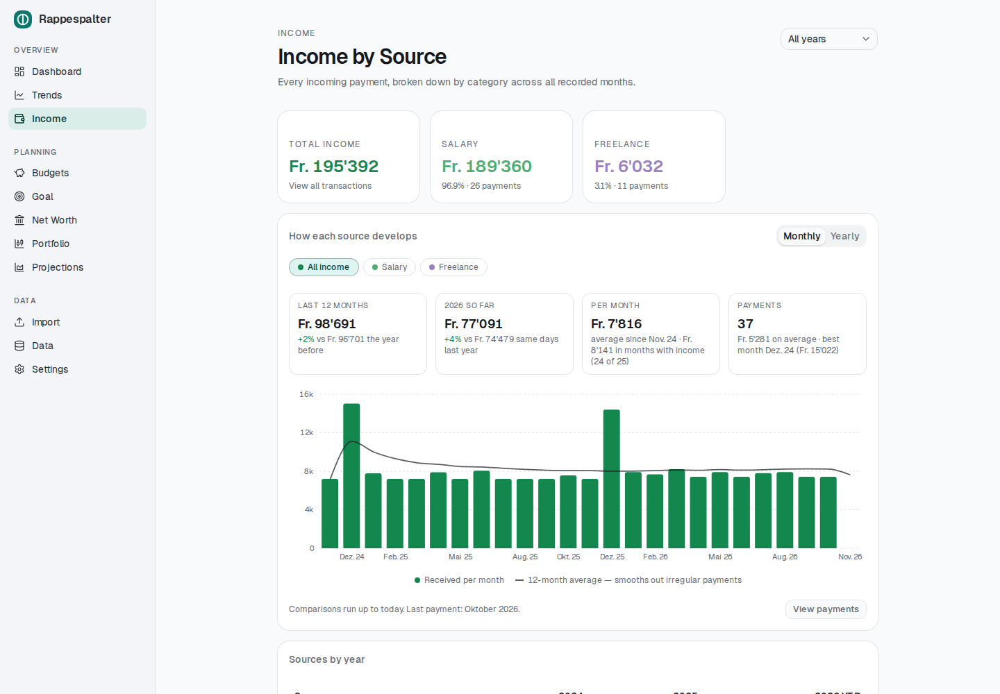
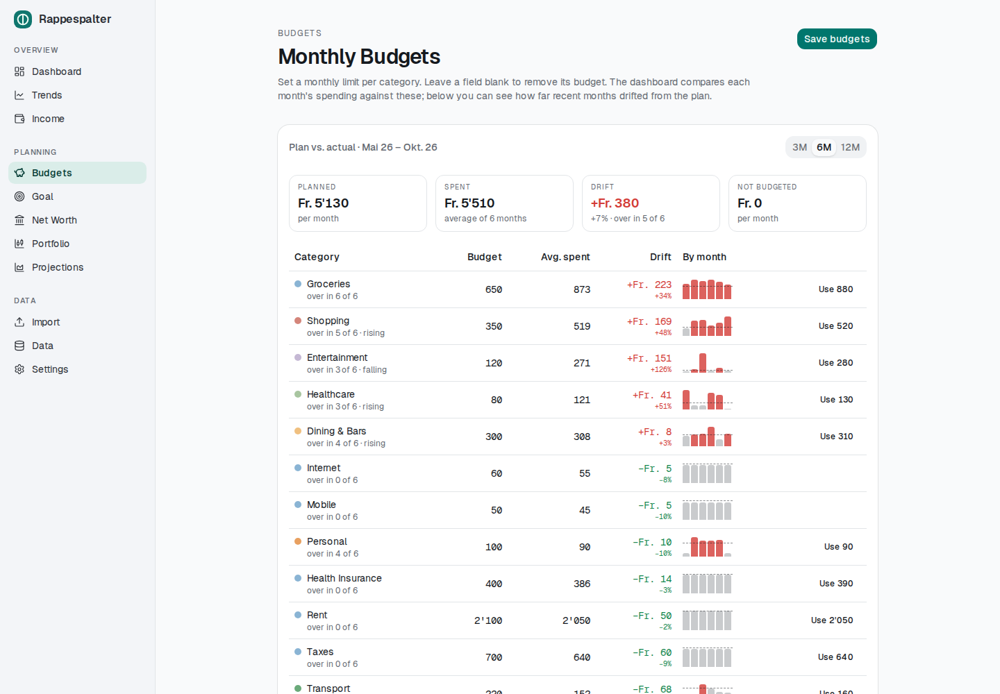
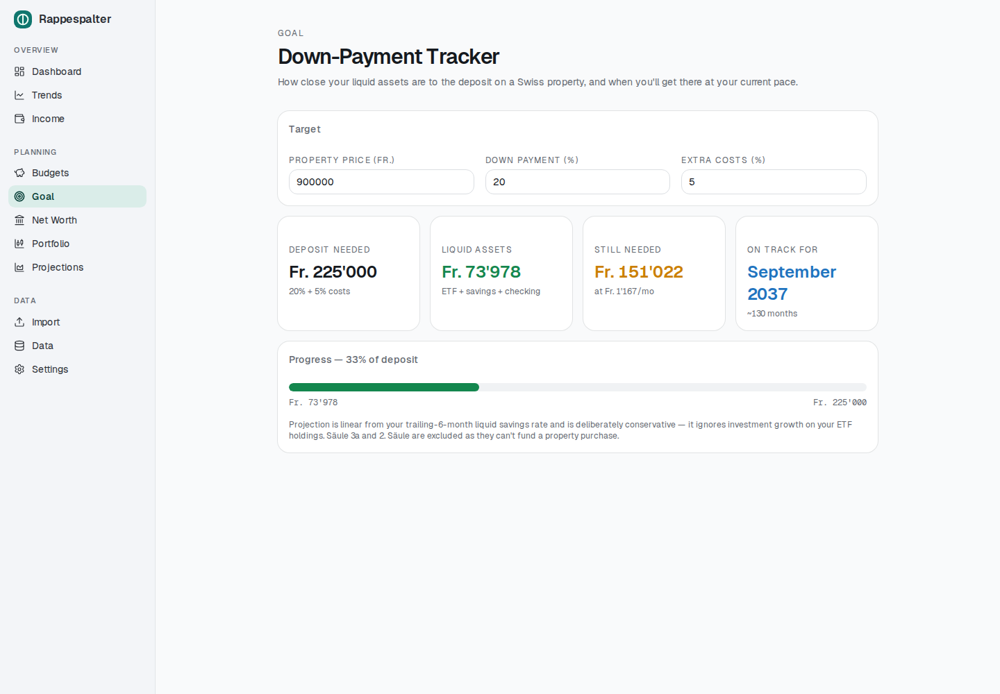
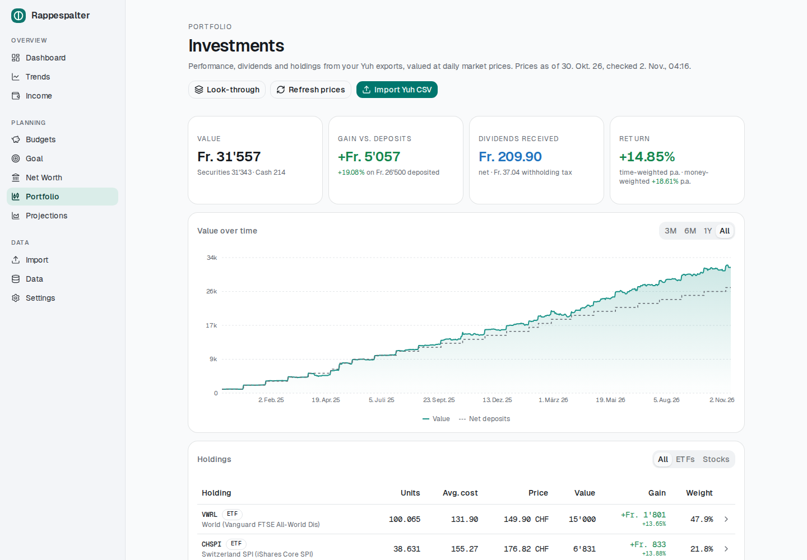
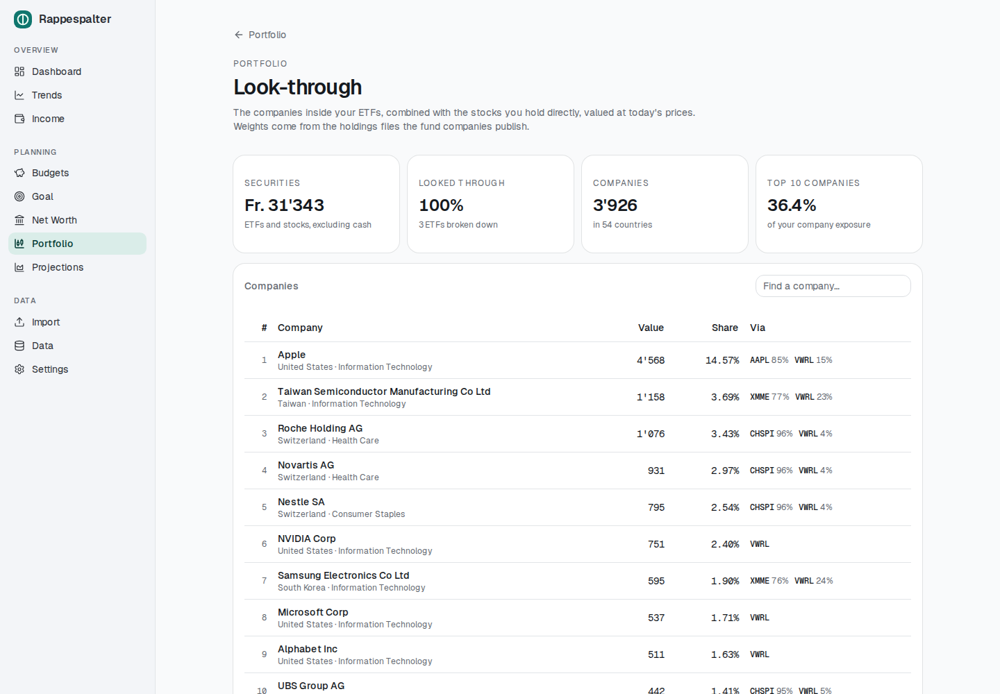
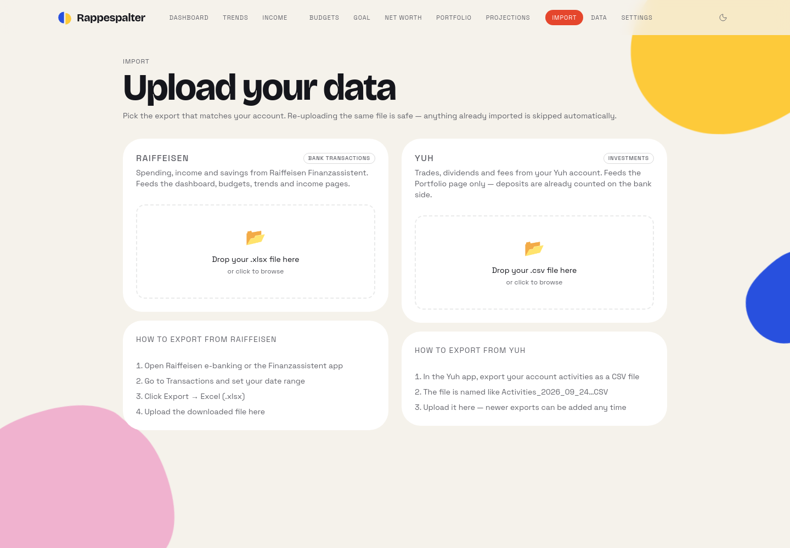
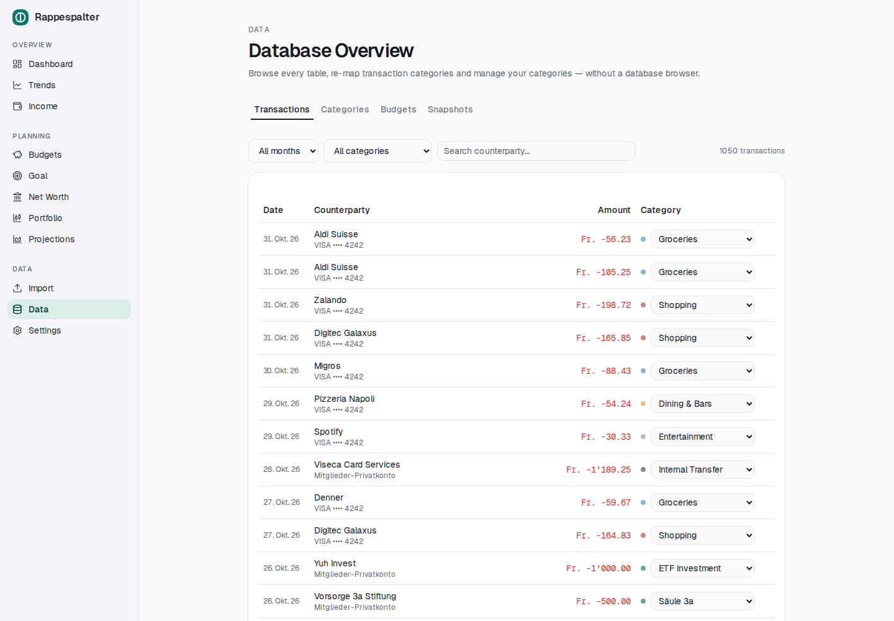
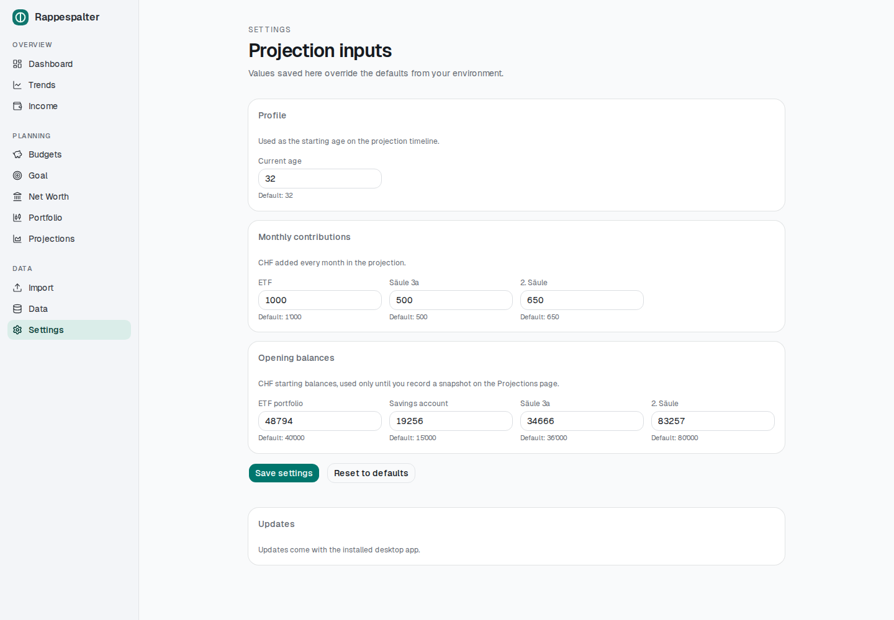

# Rappespalter

A **local-first personal finance dashboard** for tracking monthly spending, savings, net worth, and long-term wealth projections. You import your bank statements, and everything is stored and computed on your own machine — no cloud, no accounts, nothing leaves your computer.

Built for a Swiss context (CHF, pillar 2 / pillar 3a, Raiffeisen exports), but the core works for any spending/savings tracking.

---

## Screenshots

_All figures are made-up demo data (how they are made: [CLAUDE.md](CLAUDE.md#regenerating-the-readme-screenshots))._

| Dashboard | Trends |
| --- | --- |
|  |  |

| Income | Budgets |
| --- | --- |
|  |  |

| Net Worth | Goal |
| --- | --- |
|  |  |

| Portfolio | Look-through |
| --- | --- |
|  |  |

| Projections | Import |
| --- | --- |
|  |  |

| Data | Settings |
| --- | --- |
|  |  |

---

## Features

### 👋 First-start setup
A fresh install opens a short guided setup: your birth date, what you save each month (ETF, Säule 3a, 2. Säule), what your accounts hold today (recorded as your first snapshot) and your first bank export. Every step can be skipped and changed later; moving computers, you can restore a backup instead. Existing databases skip it, and Settings can run it again.

### 🌍 Languages
English, German, French and Italian, with Swiss number and date formats (`1'234.50`, `1 234,50`). The app starts in your system's language and you can switch on the first setup screen or under Settings → Appearance. Every page is translated; the terms are listed for a native speaker to review. Details and the glossary: [docs/I18N.md](docs/I18N.md).

### 📊 Dashboard
Monthly spending overview with drill-downs.
- Income / Expenses / Saved / Net stat cards, each clickable to inspect the underlying transactions
- Spending allocation (Fixed / Variable / Savings) and an expense-by-category pie chart
- Budget vs. actual progress bars per category
- Largest outflows and a separate savings & investments list
- Sortable, searchable transaction drill-down dialog

### 📥 Import
Upload a Raiffeisen **Finanzassistent** `.xlsx` export, or **camt.053 / camt.054** account statements (`.xml`, or a `.zip` of several) from any Swiss bank.
- Drag-and-drop or browse
- Automatic German→English category mapping (Raiffeisen); camt statements carry no categories, so rules and the review inbox sort them (salary is recognised)
- Transfers between your own accounts are recognised (known names, plus the same amount leaving one account and arriving in another within 3 days) and left out of totals, so card bills and savings moves aren't double-counted
- Deduplicated on re-import — re-uploading the same file imports nothing twice
- Reports imported / skipped / total counts

### 💰 Budgets
Set monthly CHF limits per category; totals roll up and feed the dashboard's budget bars.
- **Plan vs. actual** over the last 3 / 6 / 12 complete months: average spend vs. budget per category, drift in CHF and %, how many months went over, a per-month mini chart, and one click to adopt the average as the new budget
- Only months that were complete when you last imported count, so a partly imported month never looks like you stayed under budget

### ⏱️ Month pace
On the dashboard, the month in progress is projected per budget: fixed costs count once at their usual amount, variable spending continues at your usual rate — so you see "on pace for Fr. 940 in Groceries (budget 650)" while there's still time to react.

### 🏷️ Auto-categorization rules
Data → Rules: "counterparty contains *Migros* → Groceries", optionally only for money in or out. Imports apply your rules before the bank's categories; the longest matching text wins. Re-categorizing a transaction by hand offers to turn it into a rule, and rules can be applied to past transactions.

### 📈 Trends
Income, expenses, saved, and savings-rate over time (the in-progress month is excluded so averages aren't skewed). Six-month averages for savings rate and cash flow.

### 🏦 Net Worth
Net-worth history built from monthly balance snapshots — stacked composition (checking, savings, ETF, pillar 3a, pillar 2) plus a total line, split into liquid vs. locked assets.

### 🚗 Assets & debts
Everything you own beyond your accounts — gold, crypto, collectibles (one value for a whole collection, e.g. Pokémon cards), a car — plus loans, mortgages and leases. Values are entered by hand or depreciate (cars), loans follow their repayment schedule, and Net Worth adds the assets and subtracts what you owe. A car's page shows what it really costs a month (depreciation, financing, running costs from your categories) and compares leasing with buying. Adding a new kind of asset is documented in [docs/ASSETS.md](docs/ASSETS.md).

### 📉 Portfolio
Standalone investment tracker fed by **Yuh** activity CSV exports. Holdings are matched to market listings automatically (by the currency and price of your first trade — no hard-coded tickers) and valued at daily closing prices, converted to CHF.
- Value over time vs. net deposits, with 3M / 6M / 1Y / All ranges
- Time-weighted and money-weighted (IRR) returns
- Holdings: units, average cost, price, gain, weight — filterable by ETFs / stocks
- Dividends per month and per holding, withholding tax, yield on cost; trading & FX fees
- Per-holding price source: auto-matched listing, a listing you choose, or manual prices
- **Look-through**: upload each ETF's holdings file (iShares, Vanguard, Xtrackers) to see the companies, countries, sectors and currencies you actually own, combined across ETFs and directly held stocks ([details](docs/PORTFOLIO-LOOKTHROUGH.md))
- **Allocation & costs**: set target weights and see how far you've drifted, how to split your next contribution without selling, and what a full rebalance would take; enter each fund's TER to see your running costs per year (fund fees + trading fees)
- Feeds **Net Worth**: the ETF line can use the portfolio's value at each month end, and the snapshot form offers it
- Independent of the rest of the app: nothing here feeds spending, savings or net worth

### 💵 Income
Income broken down by source (category) with a monthly stacked trend, year filter, top-source ranking, and a transaction drill-down.

### 🎯 Goals
Any number of savings goals — home, travel, wedding, car, safety net, education, family or anything else — each with its own illustration. Set aside part of your accounts for each (a percentage or a fixed amount; pension money only for a home), and each goal's timeline follows your actual savings pace per account (last 6 complete months, one-offs left out, returns ignored).

### 🔮 Projections
Forecast until retirement (65 by default) on an age axis. Record balance snapshots, then the engine compounds each asset class (default rates: ETF 6%, pillar 3a 5%, savings 0.75%, pillar 2 2.5%) plus your monthly contributions. A calculator lets you try other returns, contributions, retirement ages and inflation (showing everything in today's francs) without changing your settings. A *Forecast vs. actual* card compares an earlier forecast with your snapshots since. Contribution amounts, birth date and opening balances are edited on the **Settings** page (defaults come from environment variables — see [Configuration](#configuration)).

### 🗄️ Data
A built-in database browser: paginated, filterable transaction table with inline category re-mapping, plus tabs for categories, budgets, and snapshots.

### 🖥️ Desktop app
Runs as a native desktop application via Electron — see [Desktop app](#desktop-app).

---

## Tech stack

- **Next.js 16** (App Router, Turbopack) + **React 19** + **TypeScript**
- **Tailwind CSS 4** + shadcn/ui (Radix) components
- **Recharts** for charts
- **Prisma 7** over **SQLite**, via the `@prisma/adapter-libsql` driver adapter
- **Electron** for the desktop build
- **pnpm** package manager (Node.js 22+)

---

## Getting started

### Prerequisites
- **Node.js 22+**
- **pnpm** (`npm install -g pnpm`, or via Corepack)

### Install & set up

```bash
# 1. Install dependencies
pnpm install

# 2. Create your local env file
cp .env.example .env       # Windows: copy .env.example .env

# 3. Create the SQLite database, apply migrations, and seed default categories
pnpm exec prisma migrate dev

# 4. (re)generate the Prisma client — usually run by step 3, safe to repeat
pnpm exec prisma generate

# 5. Start the dev server
pnpm dev
```

Open **http://localhost:3000**. The database file `dev.db` is created in the project root and is **gitignored** — your financial data never enters version control.

### Import your data
1. In Raiffeisen e-banking, open **Finanzassistent** and export your transactions as `.xlsx` — or, with any bank, download your account statements as **camt.053** (often called ISO 20022 or XML statements).
2. Go to **Import** in the app and upload the file.
3. Head to the **Dashboard** — months populate automatically.

> Parsers: Raiffeisen Finanzassistent in [`src/lib/parser.ts`](src/lib/parser.ts), camt statements in [`src/lib/camt.ts`](src/lib/camt.ts). Use one format per account — the same account imported both ways would count twice.

---

## Configuration

All config lives in `.env` (gitignored — copy from [`.env.example`](.env.example)).

| Variable | Purpose | Default |
| --- | --- | --- |
| `DATABASE_URL` | SQLite file location | `file:./dev.db` |
| `NEXT_PUBLIC_MONTHLY_ETF` | Monthly ETF contribution (projections) | `0` |
| `NEXT_PUBLIC_MONTHLY_3A` | Monthly pillar 3a contribution | `0` |
| `NEXT_PUBLIC_MONTHLY_PILLAR2` | Monthly pillar 2 contribution | `0` |
| `NEXT_PUBLIC_BIRTH_DATE` | Your birth date, `YYYY-MM-DD` (forecast age axis, runs until retirement) | — |
| `NEXT_PUBLIC_START_AGE` | Legacy: an age, only used to estimate a birth date when none is set | `30` |
| `NEXT_PUBLIC_INIT_ETF` / `_SAVINGS` / `_PILLAR3A` / `_PILLAR2` | Opening balances used only when no snapshot exists yet | `0` |

The `NEXT_PUBLIC_*` values are only **defaults** for the **Settings** page — anything saved there takes precedence (and works in the desktop app, where env vars are fixed at build time). Because they're personal, they stay in your local `.env` and out of the repository.

---

## Desktop app

Rappespalter can run as a standalone desktop app. It is **not** a static export — Electron launches the Next.js production server (so all API routes and the Prisma/SQLite layer work unchanged) and opens a window onto it. The database lives in your OS user-data directory and is seeded on first launch.

```bash
# Develop: run the dev server in one terminal, the Electron shell in another
pnpm dev
pnpm electron:dev

# Build a distributable installer for the current OS
pnpm dist
```

⚠️ **The SQLite layer is native, so build on the target OS.** A Windows installer must be built on Windows, a Mac one on a Mac (or in CI). The [Release workflow](.github/workflows/release.yml) builds the Windows `.exe`, the macOS (Apple silicon) `.dmg` and the Linux `.AppImage`, each on its own runner. Trigger it manually from the Actions tab, or push a `v*` tag to produce a pre-release with all three attached.

Full details, DB locations per OS, and troubleshooting are in **[docs/ELECTRON.md](docs/ELECTRON.md)**.

### Installing

Download the file for your system from the [latest release](https://github.com/amir-begic/rappespalter/releases/latest). The app updates itself after that (Settings → Updates).

| OS                    | File                                  | Install                                                    |
| --------------------- | ------------------------------------- | ---------------------------------------------------------- |
| macOS (Apple silicon) | `Rappespalter-mac-arm64.dmg`          | Open it and drag **Rappespalter** into Applications.       |
| Windows               | `Rappespalter-Setup.exe`              | Run it.                                                    |
| Linux (x64)           | `Rappespalter-linux-x64.AppImage`     | Make it executable (`chmod +x Rappespalter-linux-x64.AppImage`), then run it. |

**Linux: "AppImages require FUSE to run".** AppImages need `libfuse2`, which recent distributions no longer install by default. Install it once:

| Distribution                     | Command                          |
| -------------------------------- | -------------------------------- |
| Ubuntu 24.04+, Debian 13+        | `sudo apt install libfuse2t64`   |
| Ubuntu 22.04, Debian 12, Mint    | `sudo apt install libfuse2`      |
| Fedora                           | `sudo dnf install fuse-libs`     |
| Arch, Manjaro                    | `sudo pacman -S fuse2`           |

Where FUSE isn't available at all (containers, WSL), run it with `./Rappespalter-linux-x64.AppImage --appimage-extract-and-run`.

### Uninstalling

Removing the app leaves your data in place, so reinstalling picks up where you left off. To remove everything, delete the data folder as well. It holds the database, the automatic copies made before updates and restores (`backups/`), and a startup log. **File → Open Data Folder** in the app opens it. Make a backup first (**Settings → Backup & restore**) if you might want the data again.

| OS      | Remove the app                                                       | Data folder                                    |
| ------- | -------------------------------------------------------------------- | ---------------------------------------------- |
| macOS   | Quit it, then drag **Rappespalter** from Applications to the Trash.   | `~/Library/Application Support/Rappespalter/`  |
| Windows | **Settings → Apps → Installed apps → Rappespalter → Uninstall**.      | `%APPDATA%\Rappespalter\`                      |
| Linux   | Delete the `Rappespalter-linux-x64.AppImage` file.                   | `~/.config/Rappespalter/`                      |

On macOS the Library folder is hidden: in Finder press **⌘⇧G** and paste the path. On Windows paste the path into the Explorer address bar.

---

## Data model

SQLite via Prisma ([`prisma/schema.prisma`](prisma/schema.prisma)):

- **Transaction** — `date`, `counterparty`, `amount` (+income / −outflow), `account`, `categoryId`, `bookingText`, and a unique `sourceHash` for dedup
- **Category** — `name`, `color`, `type` (`fixed` · `variable` · `savings` · `transfer` · `income`)
- **Budget** — one `monthlyLimit` per category
- **Snapshot** — monthly asset balances: `etf`, `savings`, `pillar3a`, `pillar2`, `checking`
- **Setting** — key/value user settings (projection inputs)
- **PortfolioActivity** / **Security** / **SecurityPrice** / **FxRate** — the standalone portfolio tracker: imported broker activities, how each holding is priced, and cached daily prices and CHF exchange rates
- **FundSource** / **FundConstituent** — the latest holdings file per ETF, for the look-through
- **CategoryRule** — auto-categorization rules

**Category types** drive the math: `savings`/`transfer` are excluded from expense totals; `income` is positive cash flow; `fixed`/`variable` are spending.

---

## Project structure

```
src/
  app/
    dashboard/  import/  budgets/  trends/
    networth/   income/  goal/     projections/  data/
    api/        # transactions, summary, snapshots, budgets, categories,
                # income, trends, months, import
    layout.tsx  # top nav linking all pages
  lib/
    prisma.ts   # shared PrismaClient (libsql adapter)
    parser.ts   # Raiffeisen XLSX parser
    camt.ts     # camt.053/054 statement parser (any bank)
prisma/
  schema.prisma  migrations/  seed.ts
electron/        # desktop main + preload
scripts/         # standalone build assembly
```

---

## Commands

```bash
pnpm dev                                  # dev server (http://localhost:3000)
pnpm build                                # production web build
pnpm start                                # serve the production build
pnpm lint                                 # eslint

pnpm exec prisma studio                    # browse the DB at localhost:5555
pnpm exec prisma migrate dev --name <name> # create & apply a migration
pnpm exec prisma migrate reset             # wipe, re-migrate, re-seed
pnpm exec prisma db seed                   # seed default categories

pnpm electron:dev                         # Electron shell (needs pnpm dev running)
pnpm build:desktop                        # next build + assemble standalone bundle
pnpm dist                                 # build a desktop installer for this OS
```

---

## Privacy

Local-first by design: your statements, transactions, balances, and projections live only in your local SQLite database and `.env`. Nothing is uploaded, and both are gitignored so they can't be committed accidentally.

The **Portfolio** page is the one feature that goes online: it fetches public market prices (Yahoo Finance) and exchange rates (European Central Bank via Frankfurter), and refreshes Xtrackers ETF holdings files from DWS. Only ticker symbols, fund ISINs, currency codes and date ranges are sent — never your holdings or amounts. Prices are cached, so the page keeps working offline.

---

## License

[MIT](LICENSE)
