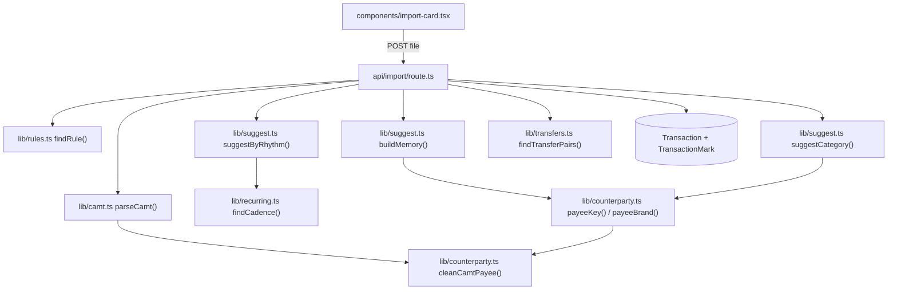
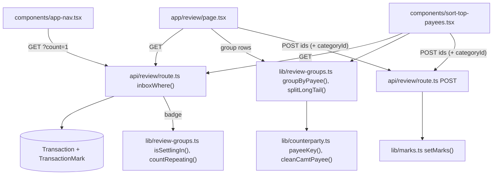

# Category suggestions

How a bank import gets from raw text to a suggested category, and which part calls
which. Everything here runs on your computer: no cloud AI, no merchant API, and no
network calls.

## The short version

camt statements have no spending categories, so every row used to arrive
uncategorized. Now each import does this:

1. **Clean the payee.** `Einkauf Muster Markt-11 Bern`, followed by a line with the
   date and card number, becomes `Muster Markt-11 Bern`.
2. **Look at history, then the built-in list.** If you always filed this payee under
   one category, the row gets that category as a suggestion. With no history, a list
   of known brands and common words can give a weaker suggestion. Failing that, a large
   amount from one payer every month is suggested as Salary, and the largest fixed
   amount to one payee every month as Rent.
3. **Ask you to confirm.** The row counts in your totals straight away but stays in
   Data → Review until someone confirms or changes it.

Rules always win over suggestions, and transfers between your own accounts override
them. A suggestion never overwrites a category that already exists.

## What calls what

### On import

`POST /api/import` decides each row's category in this order. The first match wins,
except for step 4, which can replace what came before it:

| Step | Decides | `categorySource` | Code |
|---|---|---|---|
| 1 | Your rule, tried on the cleaned name, then on the bank's original text | `rule` | `findRule` |
| 2 | Known transfer, or a payment to another account in the upload | `transfer` | parser |
| 3 | Bank information, such as salary | `bank` | parser |
| 3b | Still empty: payee history, then the built-in list | `suggested`, `suggested-brand` or `suggested-list` | `suggestCategory` |
| 3c | Still empty: a monthly salary or rent | `suggested-rhythm` | `suggestByRhythm` |
| 4 | Same amount out of one account and into another | `transfer` | `findTransferPairs` |

Step 4 replaces suggestions, but never rules or manual choices. An outgoing payment
in a savings category stays savings.

### In the review inbox

A row leaves the inbox when one of these happens:

| Action | What changes |
|---|---|
| **Looks right**, or **Accept N suggestions** | `reviewedAt` is set and the category stays |
| Pick another category | `categorySource` becomes `manual` and `reviewedAt` is set |
| Change it on Data → Transactions | Same as above |
| A rule is applied to it | `settleSuggestions()` turns its source into `rule` |

**Accept N suggestions** covers only `suggested` rows. `suggested-brand`,
`suggested-list` and `suggested-rhythm` rows are weaker guesses, so they're confirmed
one group at a time.

A group with a suggestion shows it already chosen in the picker, edged in the category's
colour, and **Looks right** is the filled button next to it (`components/category-select.tsx`).

### Keeping the first import manageable

- **Sort step in the setup:** after a bank import, `/welcome` lists the largest payee
  groups, as many as cover 80% of the payments in groups of two or more (at least 20,
  at most 60; `groupsToCover`), with how much is sorted so far (`SortTopPayees`).
  "Show N more" adds 20. It can be left at any time.
- **Everything else:** with 10 or more single-payment groups, Data → Review tucks them
  behind a button (`splitLongTail`), for every user.
- **Nav badge:** for 30 days after the first import it leaves out single payments
  (`isSettlingIn`, `countRepeating`).

## The parts

### `cleanCamtPayee(text)` in `lib/counterparty.ts`

Returns `{ name, kind }`. It keeps the first line of the text, removes the wrapper
and works out the kind:

| Bank text (first line) | `name` | `kind` |
|---|---|---|
| `Einkauf Muster Markt-11 Bern` | `Muster Markt-11 Bern` | merchant |
| `Einkauf TWINT, CAFE EXEMPEL` | `CAFE EXEMPEL` | merchant |
| `Zahlung TWINT BEISPIEL, ANNA` | `BEISPIEL, ANNA` | person |
| `Überweisung TWINT an BEISPIEL, ANNA` | `BEISPIEL, ANNA` | person |
| `Gutschrift TWINT BEISPIEL, ANNA` | `BEISPIEL, ANNA` | person |
| `Bancomat Bezug Musterbank Bern` | unchanged | cash |
| `Instant-Zahlung Stadt Muster` | `Stadt Muster` | other |
| `BEISPIEL, ANNA TWINT Nr 123` (Raiffeisen XLSX) | `BEISPIEL, ANNA` | other |

`Gutschrift Wechselkurs-Korrektur…` rows name the original purchase on line 2, so
that line is used. Text in a form it doesn't know keeps its first line. The wrappers
come from one bank's camt files, so other banks may need more patterns here.

### `payeeKey()` and `payeeBrand()` in `lib/counterparty.ts`

- **`payeeKey`** makes names comparable: it lowercases them and drops branch numbers,
  other numbers and punctuation. `Muster Markt-11 Bern` and `Muster Markt-77 Bern`
  share a key. All cash withdrawals share one key, and all deposits share another.
- **`payeeBrand`** is the key's first word, so that one branch can vouch for another.
  It's `null` for people, cash and words under three letters, because a surname says
  nothing about a category.

### `buildMemory()` and `suggestCategory()` in `lib/suggest.ts`

`buildMemory` counts categories per payee and per brand, with money in and money out
kept apart. The import route passes it every row that has a category, except:

- transfers, which the pairing step handles;
- suggestions nobody has confirmed, so that guesses can't reinforce themselves.

`suggestCategory` then tries two levels:

| Level | Needs | Result |
|---|---|---|
| Same payee | At least 80% of its payments in one category | `suggested` |
| Same first word | At least 90% in one category, and at least 3 payments | `suggested-brand` |
| Built-in list | A brand, else a common word, for money out to a shop | `suggested-list` |
| None of these | | No suggestion, so the row stays uncategorized |

The thresholds are constants at the top of `suggest.ts`.

### `suggestByRhythm()` in `lib/suggest.ts`

For rows nothing above could place, mostly on a first import. It looks at this import
and the history together, per payee and direction, and needs a monthly rhythm by the same
test as Recurring payments (`findCadence` in `lib/recurring.ts`):

| Pattern | Needs | Result |
|---|---|---|
| Money in, monthly | Typical (median) amount ≥ CHF 1,500 | Salary (else Income) |
| Money out, monthly | Typical amount ≥ CHF 800, and ¾ of the payments within 1% of it | Rent, for the largest such payee only |

People, cash and names with a comma are left out. Rent goes to one payee only because a
second large fixed payment is more often a loan, a lease or saving. Brokers and pillar 3a
providers are in the built-in list, so a monthly investment is placed before this step.
The amounts are starting values, chosen by judgement.

### The built-in list: `lib/known-payees.ts`

Plain data, with no network involved. To add a brand, add one entry.

- **`KNOWN_BRANDS`** are Swiss and international names. They match as whole words, and
  the longest match wins, so `Migros Restaurant` beats `Migros`.
- **`KNOWN_WORDS`** are common words in German, French, Italian and English. Words of six
  or more letters also match inside a word, so `Stadtapotheke` counts as `apotheke`.
- **`NOT_THE_BRAND`** blocks names that contain a brand but aren't it, like `Migros Bank`.
- **`ambiguous`** marks providers that could be several categories, like Swisscom. The
  category the user has used more wins, and with no clear preference there's no suggestion.

Matching ignores accents, and uses map lookups rather than scanning every entry. It never
applies to people, cash or incoming money. A category the database doesn't have gives no
suggestion, so a renamed category simply stops being suggested.

## Data

There's no schema change. `TransactionMark.categorySource` is a plain text column,
and the three suggested values are new values in it. `SUGGESTED_SOURCES` in `suggest.ts`
is the single list of them.

**Hashes:** `Transaction.counterparty` now holds the cleaned name, but `sourceHash`
still uses the bank's original text. Statements imported before this change therefore
still deduplicate. The original text also stays in `bookingText`, and `bankText` on
`ParsedTransaction` carries it through the import so older rules keep matching.

**Default categories:** new installs also get `Travel`, `Insurance` and `Donations`, from
`resources/template.db` and `prisma/seed.ts`. There's deliberately no migration, so
existing databases don't change. Keep the template and the seed in step.

**Older rows:** camt rows imported before this keep their long counterparty. `payeeKey`
cleans them when it reads them, so they still group and match correctly.

## How well it works

Measured on one person's real data: 723 categorised camt rows from one bank, with
suggestions from Raiffeisen XLSX history before each month.

| | Rows guessed | Guesses correct |
|---|---|---|
| Same payee | 50.9% | 90.2% |
| Same first word | 21.0% | 90.8% |
| Built-in list | 2.8% | 75.0% |
| All three | 74.7% | 89.8% |
| New user, built-in list only | 28.8% | 92.8% |

The monthly patterns, on the same file with no history: one salary payer (23 rows) and one
rent payee (13 rows), both matching the categories the person had chosen. With the list,
a new user's first import then starts with 250 of 904 rows suggested; the Sort step's
first view (23 payees) covers 422 of the remaining 654.

So with history about a quarter of rows still need a decision, and about 8% of rows get a
wrong guess until someone reviews them. That's why suggestions stay in the inbox. The
results may not carry over to other banks or people, and "correct" means it agrees with
the category already filed. The list was written with this file in view, and its French,
Italian and travel entries are largely untested.

XLSX and camt often name the same payee differently, which limits exact matches in
this test. A user whose history is camt itself should match more often: in a
prototype, payee history from earlier camt rows alone guessed 57% with 96% correct,
starting from nothing.

## Performance

Measured on fictional data in a development server:

| Work | Size | Time |
|---|---|---|
| `buildMemory` | 100,000 rows of history | about 0.3 s |
| `buildMemory` | 1,000,000 rows of history | about 2.8 s |
| `suggestCategory` | 5,000 rows | under 10 ms |
| `findKnownPayee` | 100,000 rows | about 0.5 s |
| `groupByPayee` | 2,000 rows (the inbox limit) | about 3 ms |
| Whole import | 5,000 new rows on 100,000 existing | about 32 s |
| Re-import of the same file | 5,000 rows | about 10 s |

Suggestions are a small part of an import. Most of the time goes on writing rows one at a
time in `api/import/route.ts`, and on one failed insert plus a lookup per duplicate. Batched
writes, and checking hashes up front, would be the place to speed it up.

## Known limits

- Payees that differ only by a number share a key, because `payeeKey` drops numbers.
- Suggestions run once, at import. Rows already in the database aren't revisited.
- The inbox loads at most 2,000 rows.
- Cash is one payee per direction, so it works best when all cash goes to one category.

## Considered and rejected

- **Cloud AI:** private people's names appear even in TWINT purchase rows, so no filter
  could reliably keep them out of a request.
- **Merchant enrichment APIs:** poor Swiss coverage, and they'd send transactions to a
  third party.
- **OpenStreetMap brand names:** matched few payees, and about half of those were wrong,
  so the list here is written by hand.
- **Merchant category codes:** the tested camt file doesn't contain them.
- **Naive Bayes:** not built yet. It added about 4% of rows in testing, so measure what's
  left first.
